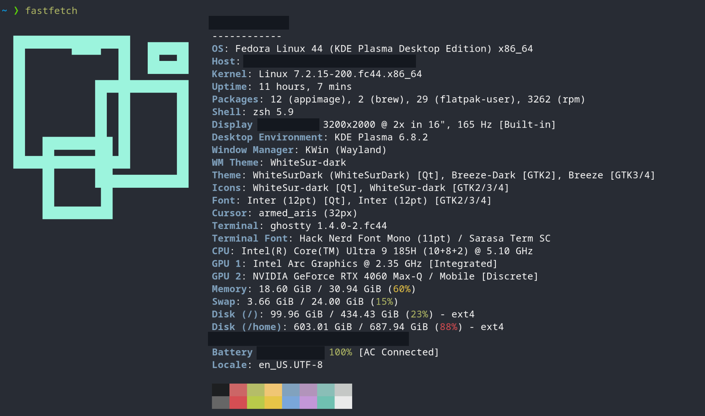

# Blue Archive Halo Fastfetch Logos

A custom logo collection for [Fastfetch](https://github.com/fastfetch-cli/fastfetch), based on Blue Archive students’ halos.

## Demo



Aris in use. Personal identifiers and network details are redacted.

## Collection


The designs use bold strokes and clear spacing inspired by Omarchy’s terminal logo. Source geometry stays intact: circular halos stay circular, and rectangular frames stay rectangular.

| Logo | Shape |
| --- | --- |
| Shiroko | Two circular rings with cardinal cross extensions |
| Serika | Two circular rings with diagonal extensions and narrow inward ends |
| Hoshino | Three circular outlines, split outer arcs, and detached side marks |
| Aris | Unequal overlapping rectangular frames and a detached upper rectangle |
| Kei | Mirrored rectangular arrangement with a separate upper tab and lower overlap channel |
| Yuzu | Two open circular rings and a separate vertical power-button bar |
| Ayane | Two circular rings with four notched cardinal marks |
| Nonomi | Two circular rings, detached upper leaves, and a lower dot and teardrop |
| Seia | Crossed diagonal arms with curved ends and triangular cutouts |
| Hanako | Two circular rings with four detached diagonal petals |
| Otogi | Circular ring with four short cardinal tabs and a central four-petal mark |
| Kurumi | Triangular frame with three pointed extensions and a detached inverted triangle |
| Yukino | Circular ring with four diagonal rays and a detached central dot |
| Kaya | Circular ring with two detached diagonal sword marks |
| Kanna | Four open diamond-ended strands with interwoven crossing gaps |
| Natsu | Two circular rings with four solid cardinal marks on the inner ring |
| Moe | Inner circular ring, four separate outer arcs, and inward triangular arrows |
| Iori | Two circular rings with three pointed radial marks |

## Install

Install [Fastfetch](https://github.com/fastfetch-cli/fastfetch) with your system's package manager first. Then install a logo as follows.

1. Clone this collection:

```sh
git clone https://github.com/Millennium-Robotics-Lab/blue-archive-halo-fastfetch-logos.git
cd blue-archive-halo-fastfetch-logos
```

2. Copy your chosen logo into the Fastfetch config directory. Run this from the clone:

```sh
logo_name=hoshino
ff_config_dir="${XDG_CONFIG_HOME:-$HOME/.config}/fastfetch"
ff_logo_dir="$ff_config_dir/logos/$logo_name"
mkdir -p "$ff_logo_dir"
cp "logos/$logo_name/logo.txt" "logos/$logo_name/logo.png" "logos/$logo_name/color" "$ff_logo_dir/"
printf 'Config file: %s\nLogo source: %s\n' "$ff_config_dir/config.jsonc" "$ff_logo_dir/logo.txt"
printf 'Logo color: '
cat "$ff_logo_dir/color"
```

Set `logo_name` to a lowercase name from the collection, such as `nonomi` or `otogi`. Run `./scripts/try-logo --list` to see all 18 names. The installed copies work independently of the clone.

3. Open the config file printed above. Replace its existing `logo` object with the example below. Keep your modules and other settings. If the file does not exist, create it with this complete example:

```json
{
  "logo": {
    "type": "file",
    "source": "/absolute/path/to/fastfetch/logos/hoshino/logo.txt",
    "color": { "1": "#ffc1d6" },
    "padding": { "right": 4 }
  }
}
```

Replace `source` with the **Logo source** path printed by the install command. Use the printed **Logo color** if you selected another character. Set `type` to `file` even if your previous config used `kitty-direct`.

4. Run Fastfetch without logo arguments to check the installed configuration:

```sh
fastfetch
```

For automatic display in new terminals, add `fastfetch` to your interactive shell's startup file, such as `~/.bashrc` or `~/.zshrc`.

### Install the PNG version

The copy command also installs `logo.png`. In a terminal that supports the Kitty graphics protocol, use this `logo` object instead:

```json
{
  "logo": {
    "type": "kitty-direct",
    "source": "/absolute/path/to/fastfetch/logos/hoshino/logo.png",
    "width": 34,
    "height": 17,
    "padding": { "right": 4 }
  }
}
```

Use the same installed directory printed above, with `logo.png` as the filename. Keep the rest of your existing config.

## Try without installing

From a clone, use the launcher to preview a logo:

```sh
./scripts/try-logo --list
./scripts/try-logo shiroko
```

The launcher uses your existing Fastfetch modules and changes only the logo for that invocation. It does not edit your settings. Bash and Fastfetch are sufficient for using the collection; Python is only needed to rebuild assets.

```sh
./scripts/try-logo nonomi
./scripts/try-logo serika ascii
./scripts/try-logo otogi mono
./scripts/try-logo kanna kitty
```

| Mode | Output |
| --- | --- |
| `text` | Colored block characters; default |
| `mono` | Block characters without embedded color placeholders |
| `ascii` | Plain `#` characters; less vertical detail |
| `kitty` | Transparent PNG through the Kitty graphics protocol |

Text logos occupy up to **34 columns × 17 rows**. A monospace font with cells about twice as tall as they are wide gives the intended proportions. `mono` follows your terminal and Fastfetch text styling.

## Use a logo directly

Run this command from the clone:

```sh
fastfetch --logo-type file --logo "$PWD/logos/hoshino/logo.txt" --logo-color-1 '#ffc1d6'
```

Set `--logo-type file` explicitly if your existing config selects an image protocol such as `kitty-direct`.

For a compatible Kitty graphics terminal:

```sh
fastfetch --logo-type kitty-direct --logo "$PWD/logos/hoshino/logo.png" --logo-width 34 --logo-height 17
```

## Files

Each `logos/<name>/` directory contains:

| File | Purpose |
| --- | --- |
| `logo.txt` | Block-character logo with Fastfetch `$1` color support |
| `mono.txt` | Block-character logo without color placeholders |
| `ascii.txt` | Plain ASCII alternative |
| `logo.png` | Transparent 680 × 680 PNG |
| `logo.svg` | Vector export of the pixel geometry |
| `design.json` | Editable 34 × 34 source grid and design notes |
| `color` | Suggested hex color used by the launcher |

`catalog.json` records names, colors, and halo reference URLs. [CREDITS.md](CREDITS.md) records attribution and asset scope.

## Rebuild and check

Use [uv](https://docs.astral.sh/uv/) to run the builder. It installs the pinned Pillow dependency in an isolated script environment.

```sh
uv run scripts/build_collection.py
uv run scripts/build_collection.py --check
uv run scripts/build_collection.py --check --fastfetch
```

The builder exports every format from the same source grid. `--check` detects stale exports without modifying files. `--fastfetch` also checks all text variants and colors against an installed Fastfetch binary.

Text output was tested with **Fastfetch 2.68.1**. PNG and SVG exports were checked against the grids. Kitty protocol display still needs testing in a compatible terminal.

See [CONTRIBUTING.md](CONTRIBUTING.md) for the design and verification steps.
