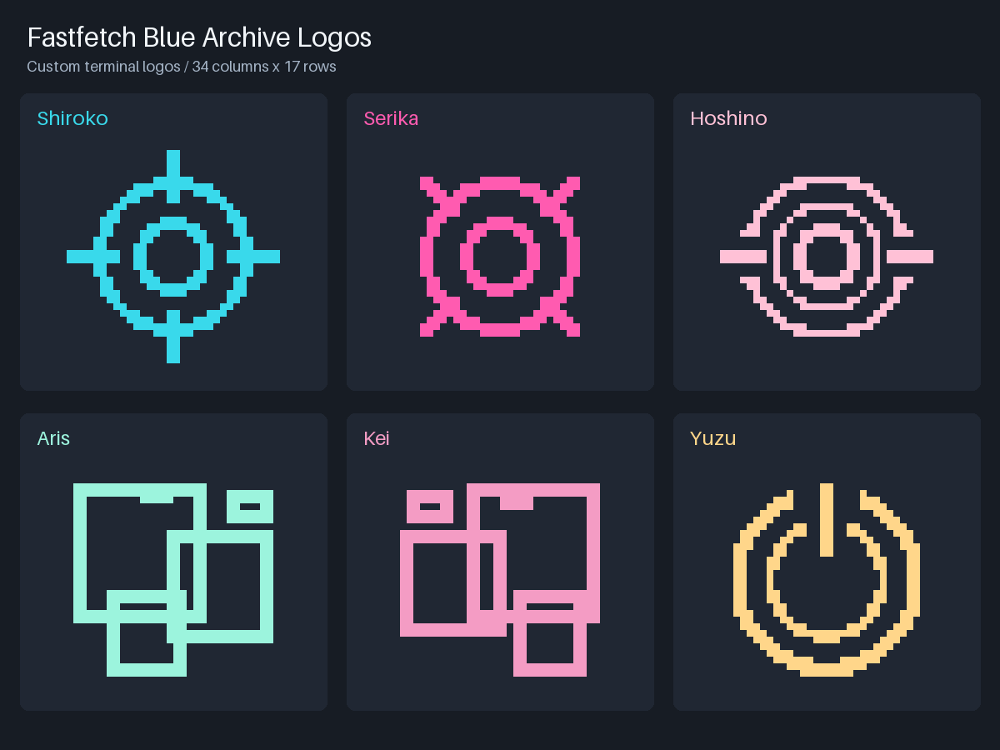

# Fastfetch Blue Archive Logos

A custom logo collection for [Fastfetch](https://github.com/fastfetch-cli/fastfetch), based on Blue Archive students’ halos.



The designs use bold strokes and clear spacing inspired by Omarchy’s terminal logo. Source geometry stays intact: circular halos stay circular, and rectangular frames stay rectangular.

| Logo | Shape |
| --- | --- |
| Shiroko | Two circular rings with cardinal extensions |
| Serika | Two circular rings with diagonal extensions |
| Hoshino | Three circular outlines with separate horizontal side marks |
| Aris | Overlapping rectangular frames with a detached upper rectangle |
| Kei | Mirrored frame arrangement with an upper tab and lower overlap channel |
| Yuzu | Two open circular rings with a vertical power-button bar |

## Quick start

Install Fastfetch, then clone this collection:

```sh
git clone https://github.com/kriss-spy/fastfetch-blue-archive-logos.git
cd fastfetch-blue-archive-logos
./scripts/try-logo --list
./scripts/try-logo shiroko
```

The launcher uses your existing Fastfetch modules and changes only the logo for that invocation. It does not edit your settings. Bash and Fastfetch are sufficient for using the collection; Python is only needed to rebuild assets.

```sh
./scripts/try-logo hoshino
./scripts/try-logo serika ascii
./scripts/try-logo aris mono
./scripts/try-logo kei kitty
```

| Mode | Output |
| --- | --- |
| `text` | Colored block characters; default |
| `mono` | Block characters without embedded color placeholders |
| `ascii` | Plain `#` characters; less vertical detail |
| `kitty` | Transparent PNG through the Kitty graphics protocol |

Text logos occupy up to **34 columns × 17 rows**. A monospace font with cells about twice as tall as they are wide gives the intended proportions. `mono` follows your terminal and Fastfetch text styling.

## Use a logo directly

Run this command from the clone:

```sh
fastfetch --logo-type file --logo "$PWD/logos/hoshino/logo.txt" --logo-color-1 '#ffc1d6'
```

Set `--logo-type file` explicitly if your existing config selects an image protocol such as `kitty-direct`.

For a compatible Kitty graphics terminal:

```sh
fastfetch --logo-type kitty-direct --logo "$PWD/logos/hoshino/logo.png" --logo-width 34 --logo-height 17
```

To make a logo persistent, merge a `logo` object like this into your Fastfetch config. Replace the example source with the absolute path to your clone:

```json
{
  "logo": {
    "type": "file",
    "source": "/absolute/path/to/fastfetch-blue-archive-logos/logos/hoshino/logo.txt",
    "color": { "1": "#ffc1d6" },
    "padding": { "right": 4 }
  }
}
```

## Files

Each `logos/<name>/` directory contains:

| File | Purpose |
| --- | --- |
| `logo.txt` | Block-character logo with Fastfetch `$1` color support |
| `mono.txt` | Block-character logo without color placeholders |
| `ascii.txt` | Plain ASCII alternative |
| `logo.png` | Transparent 680 × 680 PNG |
| `logo.svg` | Vector export of the pixel geometry |
| `design.json` | Editable 34 × 34 source grid and design notes |
| `color` | Suggested hex color used by the launcher |

`catalog.json` records names, colors, and halo reference URLs. [CREDITS.md](CREDITS.md) records attribution and asset scope.

## Rebuild and check

Use [uv](https://docs.astral.sh/uv/) to run the builder. It installs the pinned Pillow dependency in an isolated script environment.

```sh
uv run scripts/build_collection.py
uv run scripts/build_collection.py --check
uv run scripts/build_collection.py --check --fastfetch
```

The builder exports every format from the same source grid. `--check` detects stale exports without modifying files. `--fastfetch` also checks all text variants and colors against an installed Fastfetch binary.

Text output was tested with **Fastfetch 2.68.1**. PNG and SVG exports were checked against the grids. Kitty protocol display still needs testing in a compatible terminal.

See [CONTRIBUTING.md](CONTRIBUTING.md) for the design and verification steps.
